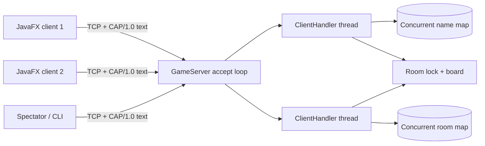
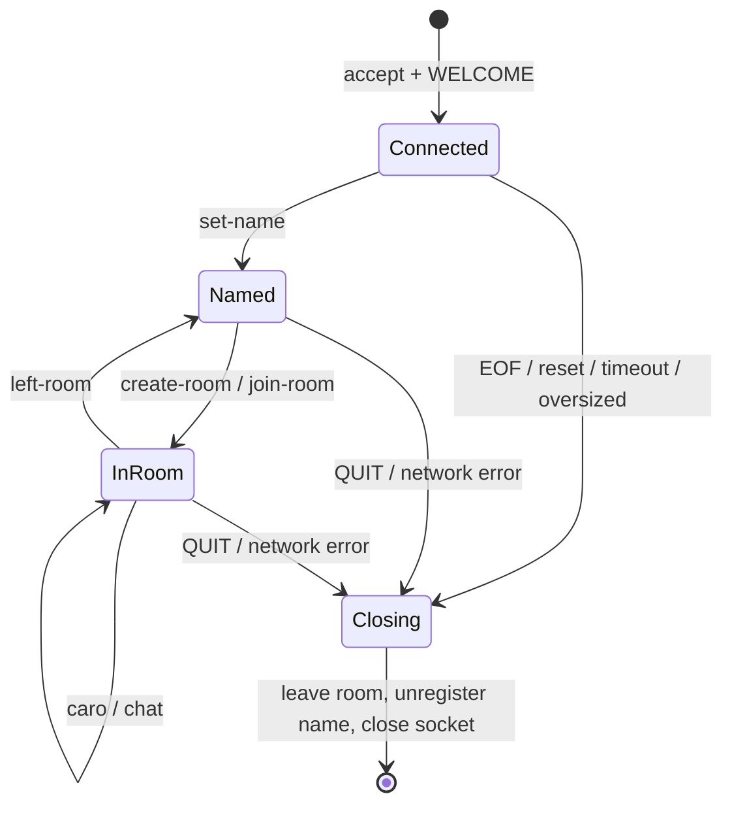

# System Architecture — Caro Arena

## 1. Mô hình tổng thể

Server dùng **thread-per-client với blocking I/O**. Mô hình này dễ giải thích, phù hợp quy mô bài tập và tách một client chậm khỏi handler khác. Nhược điểm là mỗi kết nối dùng một OS thread; nếu cần hàng nghìn kết nối nên cân nhắc Java NIO hoặc virtual thread sau khi đo tải.

## 2. Thành phần

| Thành phần | Trách nhiệm |
|---|---|
| `caro.server.Main` | Đọc biến môi trường, khởi tạo server |
| `GameServer` | Bind/accept TCP, tạo handler, quản lý name/room map |
| `ClientHandler` | Đọc frame tối đa 8 KB, parse/dispatch command, quản lý socket |
| `Room` | Bàn cờ, X/O, khán giả, lượt và kiểm tra thắng/hòa |
| `caro.protocol.TextProtocol` | Codec plain text phân cách dấu phẩy và xử lý escape |
| `caro.client.Main` | JavaFX GUI: kết nối, phòng, bàn 15×15 và chat |
| `GameConnection` / `CliMain` | Socket reader độc lập và CLI headless dùng trong Docker |

Client và server build riêng, không dùng chung class runtime. Điểm chung duy nhất là đặc tả protocol.

## 3. Shared state và khóa

| Shared state | Bảo vệ | Lý do |
|---|---|---|
| Tên online | `ConcurrentHashMap.putIfAbsent/remove(key,value)` | Đăng ký nguyên tử, không xóa nhầm session mới |
| Danh sách phòng | `ConcurrentHashMap` | Nhiều handler truy cập đồng thời |
| ID phòng | `AtomicInteger` | Không sinh trùng |
| Board, X/O, turn, status, spectators | Method thay đổi của `Room` là `synchronized` | Một lệnh `caro` được xử lý trọn vẹn |
| Ghi ra một socket | `ClientHandler.send()` là `synchronized` | Event không trộn byte |
| Cờ đóng handler | `AtomicBoolean.compareAndSet` | Cleanup idempotent |

Method của `Room` chỉ cập nhật state và tạo danh sách `Dispatch`. Việc `recipient.send()` diễn ra **sau khi đã ra khỏi synchronized method**, vì vậy client chậm không giữ khóa phòng. Code không giữ đồng thời hai khóa phòng.

## 4. Lifecycle

Người chơi rời khi trận `PLAYING` thì phòng chuyển `FINISHED`, người còn lại nhận thông báo thắng. Phòng rỗng được xóa bằng `rooms.remove(id, sameRoom)`.

## 5. Deployment

| Container | Image chạy | Entry point | Cấu hình |
|---|---|---|---|
| `server` | `eclipse-temurin:21-jre-alpine` | `caro.server.Main` | `SERVER_HOST`, `SERVER_PORT`, `CLIENT_READ_TIMEOUT_MS` |
| `client` | `eclipse-temurin:21-jre-alpine` | `caro.client.CliMain` | `CLIENT_TARGET_HOST`, `CLIENT_TARGET_PORT` |

Dockerfile dùng multi-stage Maven/JDK 21 để compile, JRE chạy CLI. `docker compose up --build` khởi động server; GUI JavaFX chạy native bằng Maven vì container Windows không có display server mặc định.

## 6. Quyết định so với mã tham khảo

Mã tham khảo dùng Swing, MySQL và message phân cách dấu phẩy; client còn tự báo `win`. Bản này chỉ tái sử dụng ý tưởng phòng, 1v1 và chat. Bỏ database giúp tập trung vào networking, còn chuyển luật lên server loại bỏ xung đột và client tự khai kết quả. CLI được chọn để chạy native lẫn Docker; GUI có thể bổ sung sau mà không đổi server nếu tuân theo protocol.
