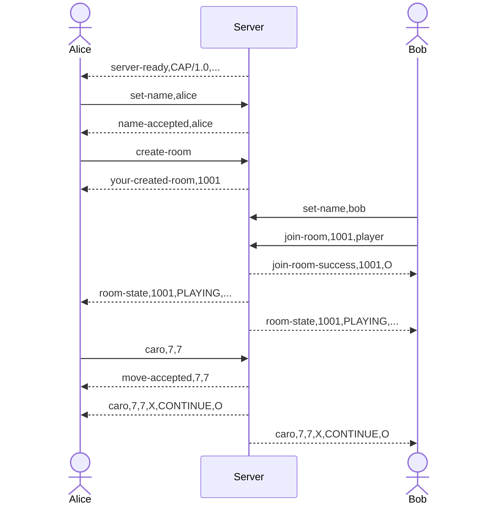

# Application Protocol Specification — CAP/1.0

## 1. Tổng quan

| Thuộc tính | Lựa chọn | Lý do |
|---|---|---|
| Mô hình | Client–Server, server-authoritative | Server quản lý phòng, lượt, bàn cờ và kết quả |
| Transport | TCP | Nước đi cần tin cậy và đúng thứ tự |
| Cổng mặc định | `5000` | Có thể đổi bằng biến môi trường |
| Framing | Mỗi message kết thúc bằng `\n` | Dễ đọc và debug giao thức text |
| Định dạng | Plain-text command, trường phân cách bằng `,` | Phù hợp CAP/1.0 và mã tham khảo |
| Encoding | UTF-8 | Hỗ trợ nội dung tiếng Việt |
| Session | Stateful | Tên, phòng và vai trò gắn với kết nối TCP |
| Concurrency | Thread-per-client, lock-per-room | Client độc lập; các phòng không chặn nhau |

## 2. Framing và escaping

```text
COMMAND[,PARAMETER_1[,PARAMETER_2...]]\n
```

TCP là byte stream nên server tích lũy byte đến `\n` rồi mới parse. Frame tối đa 8192 byte UTF-8, không tính newline. Frame vượt giới hạn nhận `error,413,...` rồi kết nối bị đóng.

Các ký tự đặc biệt trong field được escape:

| Giá trị thật | Trên wire |
|---|---|
| `\` | `\\` |
| `,` | `\,` |
| newline | `\n` |
| carriage return | `\r` |

Ví dụ chat có dấu phẩy:

```text
chat,Xin chao\, Bob
```

Escape không hợp lệ trả `error,400,...` và không thay đổi trạng thái game.

## 3. Command Client → Server

| Command | Tham số | Ý nghĩa |
|---|---|---|
| `hello` | — | Kiểm tra phiên bản protocol |
| `set-name` | `<name>` | Đặt tên duy nhất gồm 3–20 chữ, số hoặc `_` |
| `ping` | — | Kiểm tra kết nối |
| `view-room-list` | — | Lấy danh sách phòng |
| `create-room` | `[password]` | Tạo phòng; bản hiện tại chỉ chấp nhận phòng public |
| `join-room` | `<roomId>[,<player|spectator>]` | Tham gia chơi hoặc xem |
| `left-room` | — | Rời phòng hiện tại |
| `caro` | `<row>,<col>` | Đánh tại tọa độ 0–14 |
| `chat` | `<content>` | Chat 1–300 ký tự trong phòng |
| `quit` | — | Đóng session đúng cách |

Các command tài khoản, bạn bè, xếp hạng, thách đấu và đề nghị hòa trong tài liệu tham khảo chưa thuộc scope phiên bản này.

## 4. Response và Server Push

| Message | Trường | Ý nghĩa |
|---|---|---|
| `server-ready` | `<version>,<message>` | Gửi ngay khi accept socket |
| `hello-ok` | `<version>` | Xác nhận protocol |
| `name-accepted` | `<name>` | Tên hợp lệ |
| `pong` | — | Phản hồi ping |
| `room-list` | `<summary>` | Các phòng cách nhau bằng `;`; mỗi phòng dạng `id:status:X:O:spectators` |
| `your-created-room` | `<roomId>` | Tạo phòng thành công, client giữ quân X |
| `join-room-success` | `<roomId>,<X|O|SPECTATOR>` | Vào phòng thành công |
| `room-state` | `<id>,<status>,<X-name>,<O-name>,<turn>,<spectators>,<board>` | Snapshot đầy đủ; board là 225 ký tự `X`, `O`, `.` |
| `move-accepted` | `<row>,<col>` | Xác nhận request nước đi |
| `caro` | `<row>,<col>,<mark>,<outcome>,<nextTurn>` | Broadcast nước đi đã được server kiểm tra |
| `game-over` | `<WIN|DRAW>,<winner>` | Kết thúc ván |
| `chat-accepted` | — | Xác nhận gửi chat |
| `chat` | `<from>,<content>` | Broadcast chat |
| `left-room` | `<roomId>` | Xác nhận rời phòng |
| `player-left` | `<name>,<reason>,<winner>` | Người chơi/khán giả rời phòng |
| `quit-ack` | — | Xác nhận đóng session |
| `error` | `<code>,<message>` | Lỗi có thể hiển thị cho người dùng |

## 5. Status code

| Code | Tên | Ý nghĩa |
|:---:|---|---|
| 200 | `OK` | Thành công; các response thành công dùng command riêng thay vì kèm code |
| 201 | `CREATED` | Tạo phòng thành công |
| 400 | `BAD_REQUEST` | Sai command, field, escape hoặc kiểu dữ liệu |
| 401 | `UNAUTHORIZED` | Chưa đặt tên session |
| 403 | `FORBIDDEN` | Vai trò không được thực hiện hành động |
| 404 | `NOT_FOUND` | Không tìm thấy phòng |
| 408 | `TIMEOUT` | Không nhận frame trước read timeout |
| 409 | `CONFLICT` | Trùng tên, sai lượt, ô đã đánh hoặc phòng đầy |
| 413 | `TOO_LARGE` | Frame vượt 8192 byte |
| 500 | `INTERNAL_ERROR` | Lỗi server không mong đợi |

## 6. Luồng chơi



## 7. Luật và an toàn

- Bàn 15 × 15, X đi trước, ít nhất 5 quân liên tiếp ngang/dọc/chéo là thắng; không xét chặn hai đầu.
- Server kiểm tra session, role, phòng, lượt, tọa độ, ô trống và kết quả. Không nhận lệnh `win`/`lose` từ client.
- Mỗi `Room` xử lý thay đổi state trong synchronized method; network I/O thực hiện sau khi nhả khóa.
- Socket bật TCP keep-alive và read timeout mặc định 120 giây (`CLIENT_READ_TIMEOUT_MS`).
- JSON không còn được hỗ trợ. Client cũ phải nâng cấp cùng server.
- EOF, reset, timeout và `quit` đều cleanup tên, phòng và socket đúng một lần.
